  <a href="https://tokscale.ai/u/kyunglin-ryu">Tokscale profile ↗</a>
  &nbsp; · &nbsp;
  <a href="https://tokscale.ai/leaderboard?period=all&amp;sortBy=tokens&amp;search=kyunglin-ryu">All-time token ranking ↗</a>
  &nbsp; · &nbsp;
  <a href="https://github.com/kyunglin-ryu">GitHub ↗</a>

Data &amp; automatic updates

- Statistics come exclusively from my public [Tokscale profile](https://tokscale.ai/u/kyunglin-ryu). The activity calendar represents **AI usage**, not GitHub contributions.
- Token totals include cached context. Costs, where shown, are model-price estimates rather than subscription charges.
- Rank is **all-time, sorted by tokens**, not monthly rank or cost rank.
- The profile uses one black dashboard, regardless of GitHub's theme.
- [GitHub Actions](https://github.com/kyunglin-ryu/kyunglin-ryu/actions/workflows/profile-dashboard.yml) refreshes the dashboard every six hours. Manual refresh is available with **Run workflow**. Scheduled runs and image caches can delay visibility.
- Run `npx --yes tokscale@latest submit` on this computer to publish new usage. GitHub Actions only reads public statistics: it does not read local conversations, submit usage logs, or access private GitHub activity.
- Regenerate locally with Node.js 22 or newer:

  `node scripts/update-profile.mjs`

- Dashboard UI adapted from [Hyunjae's profile](https://github.com/nowhere-present/nowhere-present).

